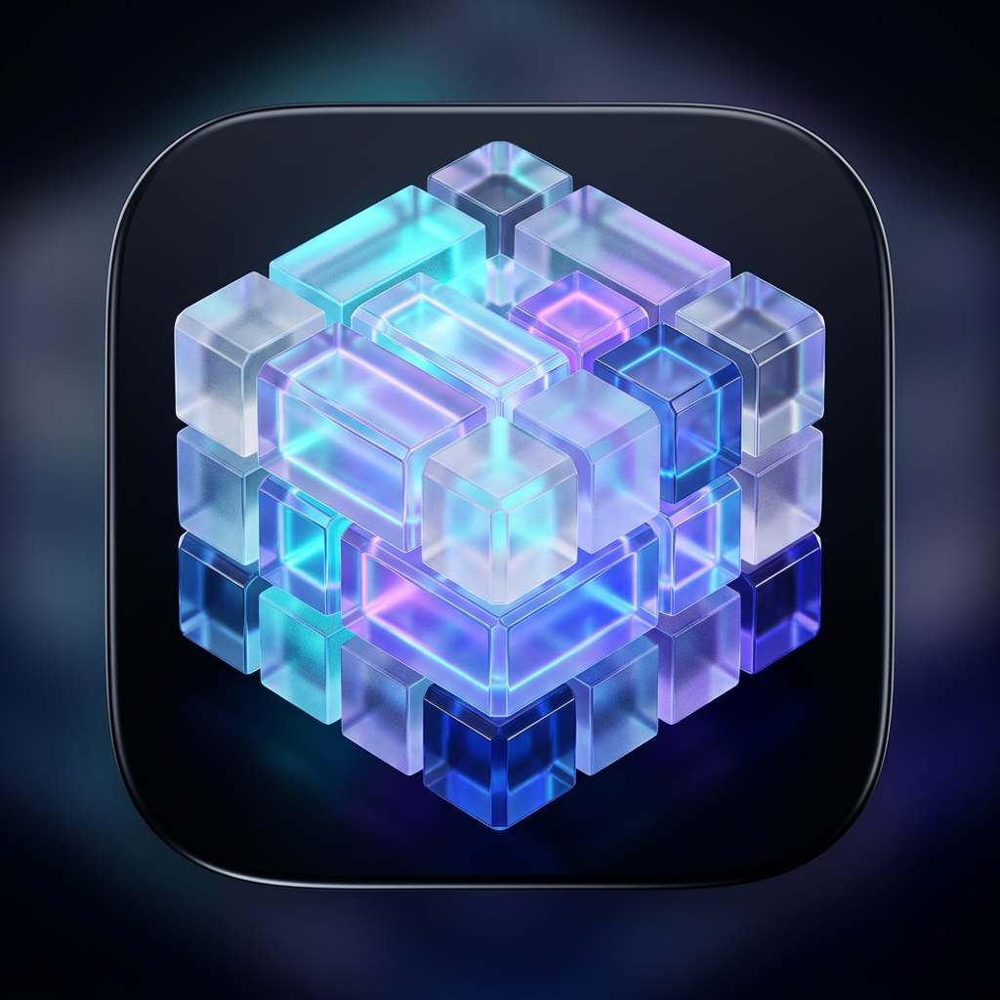

<div align="center">

  

  <br/><br/>

  # ⚡ AuraGrid
  ### Next-Gen Acrylic Bento HUD & Reactive Desktop Ambilight for Windows 11 / 10

  <p align="center">
    <b>A modular, translucent Bento widget architecture designed for desktop ricing, productivity, and media streaming.</b><br/>
    <i>Unifies kinetic magnetic snapping, real-time hardware telemetry, 60 FPS CAVA audio spectrum, and ambient reactive lighting into a 100% transparent DirectComposition layer.</i>
  </p>

  <p align="center">
    <a href="#english">English</a> •
    <a href="#español">Español</a> •
    <a href="#-quick-start">Quick Start</a> •
    <a href="#-tech-architecture">Architecture</a> •
    <a href="#-license">License</a>
  </p>

  <p align="center">
    
    
    
    
    
  </p>

</div>

---

<a name="english"></a>
## 🌐 English

### 💎 What is AuraGrid?
**AuraGrid** is an ultra-lightweight, modular Bento Desktop HUD built to bring the beloved aesthetics of modern Linux/Wayland desktop ricing (Hyprland, Waybar, Unixporn) to Windows 11. 

Running as a native transparent overlay via Windows DirectComposition, AuraGrid floats seamlessly over your wallpaper with zero borders and full click-through compatibility. Its kinetic **SnapEngine** enables cubes to magnetically fuse into cohesive, acrylic Bento clusters, with **0.0% CPU consumption at idle**.

<div align="center">
  
</div>

### ✨ Core Highlights

1. **🧩 Kinetic Bento Clustering (SnapEngine):**
   - Free-form drag-and-drop snapping in horizontal, vertical, and 2x2 grid configurations.
   - Smooth morphing into unified rectangular glass panels with shared acrylic blur and hairline cell dividers.
   - Decouple any cube at will or reorganize on the fly.

2. **🌈 Reactive Aura Glow (Desktop Ambilight):**
   - Live ambient illumination projecting dynamic color halos directly onto your wallpaper.
   - Automatically pulses and beats in sync with bass frequencies from your media or system loopback audio.

3. **📊 CAVA 60 FPS Audio Visualizer:**
   - 3 dynamic visualizer modes: Classic Fluent Bars (Equalizer), Liquid Smooth Waveform, and Radial Pulsating Spectrum Ring.
   - **Smart Sleep:** Automatically sleeps when audio is paused or silent, cutting GPU usage down to zero.

4. **⚡ Zero-CPU System Telemetry:**
   - Real hardware metrics queried directly through Windows APIs (CPU %, RAM GB used/free, GPU VRAM, Network load, Uptime).
   - High-DPI rolling sparkline graph with real-time history.

5. **🎧 Media Hub & 3-Band Parametric EQ:**
   - Multi-format player (`.mp3`, `.flac`, `.wav`, `.ogg`, `.m4a`) with drag-and-drop playlist queue.
   - Windows System Audio Loopback (WASAPI) to visualize Spotify, YouTube, or gaming audio.
   - Synchronized Karaoke lyrics (`.lrc`) with smooth auto-scroll.

6. **🐱 Bongo Cat Typing Companion:**
   - Real-time keystroke reactivity (left/right paws mapped to hardware keys) with live KPS action meter.
   - Optional mechanical acoustic typing sound effects (SFX).

7. **⚡ Low-Power PC Mode:**
   - Auto-detects modest hardware (≤ 4 CPU threads) and switches to lightweight matte glass, ensuring butter-smooth performance on older laptops and legacy PCs.

---

<a name="español"></a>
## 🇪🇸 Español

### 💎 ¿Qué es AuraGrid?
**AuraGrid** es un entorno HUD de escritorio modular estilo Bento, diseñado para trasladar la estética contemporánea del *desktop ricing* de Linux/Wayland (Hyprland, Waybar) a Windows 11 y 10.

Opera mediante una capa transparente de aceleración por hardware con DirectComposition de Windows, integrándose directamente sobre tu fondo de pantalla sin bordes toscos. Su motor **SnapEngine** permite que los cubos se atraigan magnéticamente y se fusionen en elegantes bloques Bento unificados, manteniendo un **consumo de CPU en reposo del 0.0%**.

### ✨ Características Principales

* **Fusión Cinética Bento:** Arrastra y conecta cubos libremente en horizontal, vertical o cuadrícula 2x2. Al unirse, forman un panel de cristal acrílico continuo y uniforme.
* **Aura Glow Ambilight:** Halo de luz ambiental reactivo que se proyecta sobre el escritorio y late al ritmo de la música.
* **Espectro de Audio CAVA a 60 FPS:** Visualizador de espectro en tiempo real con 3 modos (Barras Fluent, Onda Líquida y Anillo Radial). Se duerme automáticamente al pausar el audio.
* **Telemetría de Hardware Real:** Métricas exactas de CPU, memoria RAM en GB, GPU y red con gráfico Sparkline fluido.
* **Media Hub & Ecualizador Paramétrico:** Reproductor multimedia con soporte para archivos locales, captura de audio de Windows (Spotify/YouTube/Juegos) y letras sincronizadas `.lrc`.
* **Modo Oclusión para Juegos:** Congela automáticamente animaciones cuando juegas a pantalla completa para dejar el 100% de los recursos a tu juego.
* **Modo Bajo Consumo:** Optimizado para procesadores antiguos o modestos mediante rasterizado directo por GPU y supresión de shaders pesados.

---

<a name="-quick-start"></a>
## 🚀 Instalación y Uso Rápido (Quick Start)

### Opción 1: Ejecutable Portátil (Sin instalación)
1. Descarga el paquete de lanzamiento desde la sección **Releases**.
2. Descomprime la carpeta y ejecuta **`Lanzar-AuraGrid.bat`** (o `CubeWorld.exe`).
3. ¡Listo! AuraGrid flotará de inmediato sobre tu fondo de pantalla.

### Opción 2: Desde el Código Fuente
Requiere **Node.js (v18+)** instalado:

```bash
# 1. Clonar el repositorio
git clone https://github.com/saenz/AuraGrid.git
cd AuraGrid

# 2. Instalar dependencias
npm install

# 3. Iniciar la aplicación
npm start
```

### Empaquetar la aplicación en archivo `.asar`:
```bash
npx @electron/asar pack staging-app dist/CubeWorld-win32-x64/resources/app.asar
```

---

<a name="-tech-architecture"></a>
## 🛠️ Arquitectura Técnica

```
┌────────────────────────────────────────────────────────┐
│                   AuraGrid Desktop                     │
│    (Transparent Windows DirectComposition Surface)     │
└──────────────────────────┬─────────────────────────────┘
                           │
         ┌─────────────────┼─────────────────┐
         ▼                 ▼                 ▼
 ┌───────────────┐ ┌───────────────┐ ┌───────────────┐
 │  SnapEngine   │ │  AudioEngine  │ │  Telemetry    │
 │ (Event-driven │ │ (WebAudio API │ │ (Real Windows │
 │  Morphing &   │ │  CAVA 60 FPS  │ │  Hardware     │
 │  Clustering)  │ │  Ambilight)   │ │  APIs & D3D)  │
 └───────────────┘ └───────────────┘ └───────────────┘
```

* **Renderizador:** Chromium / Electron con DirectComposition D3D11 nativo.
* **Optimización de Memoria:** Heap V8 acotado (`--max-old-space-size=128`), `--enable-zero-copy` y `--enable-gpu-rasterization`.
* **CPU en Reposo:** **0.0%** verificado mediante timers inteligentes basados en inactividad.

---

<a name="-license"></a>
## 📄 Licencia & Créditos

* **Autor:** Creado y diseñado por **[Saenz](https://github.com/saenz)**.
* **Licencia:** Distribuido bajo la **Licencia MIT**. Eres libre de modificarlo, distribuirlo y utilizarlo en tus propios setups de personalización.
* **Contribuciones:** ¡Pull requests, sugerencias y nuevos cubos de la comunidad son bienvenidos!

---

<div align="center">
  <sub>AuraGrid • Designed with passion for aesthetic minimalism and high-performance computing.</sub>
</div>
