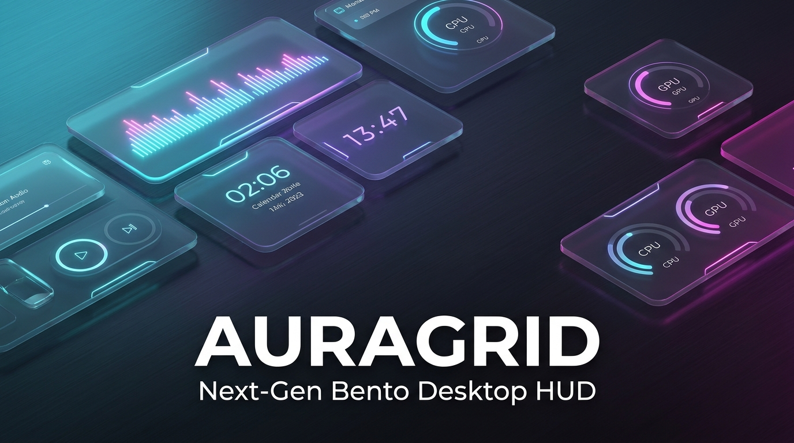
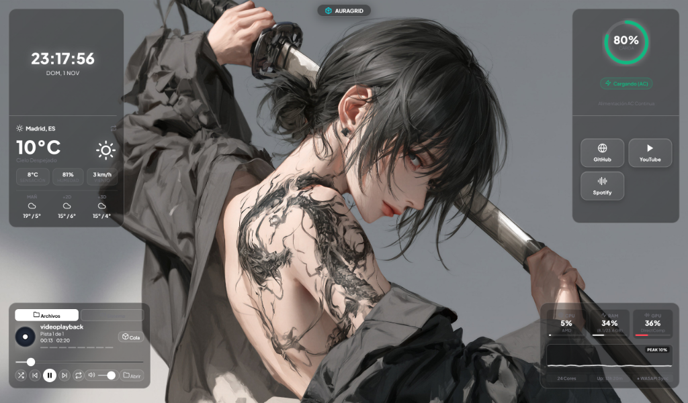
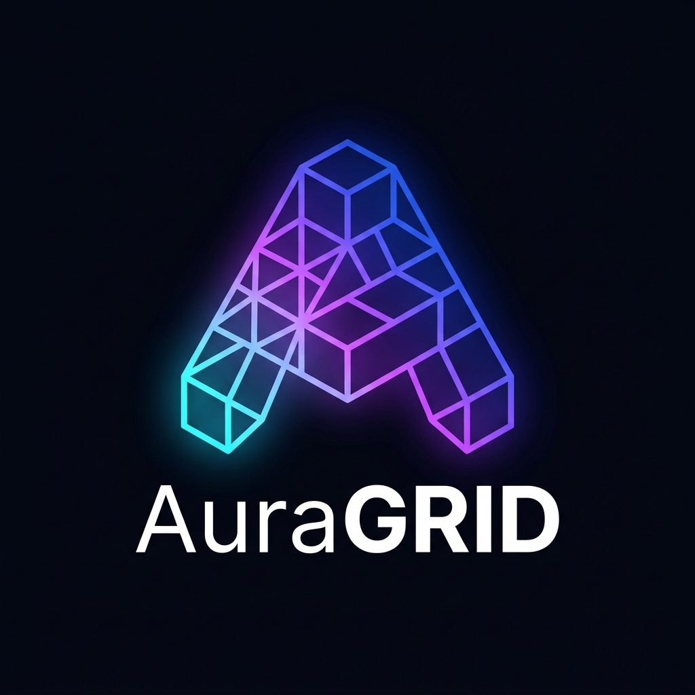
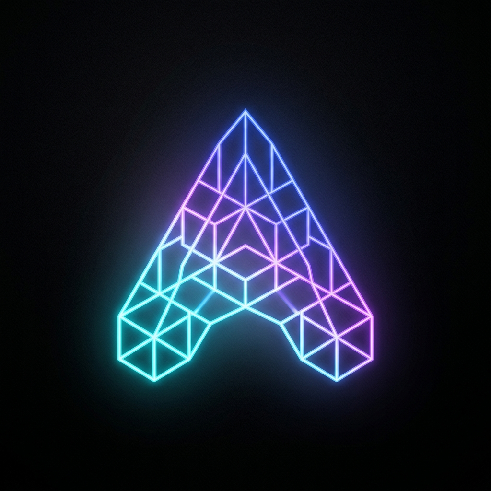

<div align="center">

  

  <br/><br/>

  # ⚡ AuraGrid
  ### Next-Gen Acrylic Bento HUD & Reactive Desktop Ambilight for Windows 11 / 10

  <p align="center">
    <b>A modular, translucent Bento widget architecture engineered for desktop ricing, hardware monitoring, and media streaming.</b><br/>
    <i>Fuses kinetic magnetic snapping, real-time hardware telemetry, 60 FPS CAVA audio spectrum, and ambient reactive lighting into a 100% transparent DirectComposition surface.</i>
  </p>

  <p align="center">
    <a href="#-desktop-preview">Preview</a> •
    <a href="#-features">Features</a> •
    <a href="#-widget-suite">Widget Suite</a> •
    <a href="#-quick-start">Quick Start</a> •
    <a href="#-ricing-studio">Ricing Studio</a> •
    <a href="#-developer-guide">Dev Guide</a> •
    <a href="#-español">Español</a>
  </p>

  <p align="center">
    
    
    
    
    
  </p>

</div>

---

<a name="-desktop-preview"></a>
## 🖥️ Live Desktop Preview (Producción Real)

Below is an authentic screenshot of **AuraGrid** running live on a Windows 11 desktop with an anime katana wallpaper, showcasing the fused acrylic Bento glass modules:

<div align="center">
  
  <p><sub><b>Fig 1.</b> AuraGrid Desktop HUD: Fused Weather & Clock Bento cluster (top-left), Media Hub (bottom-left), Battery & StreamDeck (top-right), and Real-time Hardware Telemetry (bottom-right).</sub></p>
</div>

---

<a name="-features"></a>
## ✨ Core Highlights

* **🧩 Kinetic Bento Clustering (SnapEngine):** Cubes automatically detect proximity and magnetically fuse into unified rectangular glass panels with shared acrylic blur and hairline cell dividers. Freely connect vertically, horizontally, or in asymmetric Bento grids.
* **🌈 Reactive Aura Glow (Desktop Ambilight):** Projects a dynamic, rhythmic ambient color halo directly onto your desktop wallpaper that beats in sync with the bass frequencies of your music.
* **⚡ 0.0% CPU at Idle (Zero-Polling Architecture):** Verified zero CPU footprint when idle. Uses event-driven listeners and intelligent graphic sleep when audio or user interaction stops.
* **🎮 Fullscreen Game Mode Occlusion:** Automatically pauses canvas render loops and GPU calls when you launch full-screen games or applications, leaving 100% of your GPU/CPU power for gaming.
* **🎧 Windows System Audio Loopback (WASAPI):** Capture and visualize music from Spotify, YouTube, Discord, VLC, or video games without audio doubling or echo feedback.
* **🎨 1-Click Ricing Presets:** Transform the entire visual aesthetic instantly with curated themes (*Caelestia Cyan*, *Noctalia Twilight*, *Serpentinum*, *Cyberdeck 2077*, and *Minimal HUD*).
* **🔤 Multi-Engine Typography:** Instant cascade across all widgets with native fallback stacks (*Plus Jakarta Sans*, *JetBrains / Cascadia Code*, *Outfit*, and *Orbitron*).
* **💻 Low-Power PC Mode:** Automatically detects lightweight hardware (≤ 4 CPU threads) and optimizes shaders to ensure smooth 60 FPS performance on modest laptops.

---

<a name="-widget-suite"></a>
## 📦 The 12 Modular Bento Widgets

| Widget | Icon | Description | Key Features |
| :--- | :---: | :--- | :--- |
| **Media Hub** | 🎵 | Audio player & system visualizer hub | Spinning vinyl, seekbar, local tracks + WASAPI loopback capture |
| **Audio CAVA** | 📊 | 60 FPS real-time audio spectrum | 16-band log equalizer, Waveform oscilloscope, and Radial spectrum |
| **Telemetry** | ⚡ | Real-time system hardware monitor | Accurate CPU %, RAM GB, GPU VRAM, network load, and sparkline graph |
| **Weather & Clock** | 🌤️ | Live meteorology & digital clock | Temperature, weather condition, humidity, wind, 3-day forecast, 24h clock |
| **Tasks & Notes** | 📝 | Persistent markdown checklist | Interactive task items, filter tabs (All/Pending/Done), inline text editing |
| **Bongo Cat** | 🐱 | Interactive typing desk companion | Dual-paw keyboard smash, live KPS meter, audio head bobbing, mechanical SFX |
| **Crypto Ticker** | 📈 | Real-time cryptocurrency prices | Live prices & 24h percentage delta pills for BTC, ETH, and SOL |
| **Battery & Power** | 🔋 | Circular battery gauge & power state | SVG animated circle, charging detection, AC adapter state tag |
| **StreamDeck** | 🕹️ | Programmable touch action launchpad | Quick shortcuts for Terminal, Mute, HUD Lock, Settings, GitHub, and Web |
| **Photo Frame** | 🖼️ | Smooth slideshow picture frame | Multi-photo dropzone, clipboard paste (`Ctrl + V`), crossfade animation |
| **MIDI FX Studio** | 🎛️ | 3-band parametric acoustic equalizer | LowShelf 120Hz, Mid Peak 1kHz, HighShelf 3.8kHz, Drive tube distortion |
| **Karaoke Lyrics** | 🎤 | Synchronized timestamp lyrics | `.lrc` file parser, auto-scroll, active line glowing highlight |

---

<a name="-quick-start"></a>
## 🚀 Quick Start & Installation

### Option A: Portable Standalone Release (Zero Setup)
1. Head to the **[Releases](https://github.com/AceRevo/AuraGrid/releases)** tab and download `AuraGrid-v2.0.0-win32-x64.zip`.
2. Extract the folder anywhere on your PC (e.g. `C:\Tools\AuraGrid`).
3. Double-click **`Lanzar-AuraGrid.bat`** (or `CubeWorld.exe`).
4. **AuraGrid** will immediately float smoothly over your Windows desktop.

### Option B: Run from Source
Prerequisites: **Node.js (v18+)** and **npm** installed.

```bash
# 1. Clone the repository
git clone https://github.com/AceRevo/AuraGrid.git
cd AuraGrid

# 2. Install dependencies
npm install

# 3. Launch AuraGrid in development mode
npm start
```

### Packaging into Production ASAR:
To compile and package the staging files into the production bundle:
```bash
npx --yes @electron/asar pack staging-app dist/CubeWorld-win32-x64/resources/app.asar
```

---

<a name="-ricing-studio"></a>
## 🎨 Ricing Studio & Customization

Press **`Ctrl + ,`** to open the **Centro de Configuración & Ricing Studio**:

<div align="center">
  
</div>

### 1. Curated Ricing Archetypes
* **Caelestia Cyan:** Deep cyan aurora glass with Bento Wayland rounded frames and Outfit typography.
* **Noctalia Twilight:** Velvet twilight purple with Linux Obsidian frame textures and modern sans.
* **Serpentinum:** Emerald matrix green with code-first JetBrains Mono styling.
* **Cyberdeck 2077:** High-contrast neon yellow and cyan with Orbitron tech HUD typography.
* **Minimal HUD:** 100% borderless, shadowless crystal glass for maximum desktop minimalism.

### 2. Material You Wallpaper Color Extractor
Click **"Cargar Wallpaper"** in the Settings menu to extract the dominant vibrant chromatic accent directly from your desktop wallpaper image and tint the entire HUD suite dynamically.

### 3. Glassmorphism Sliders
Fine-tune **Blur Intensity (0-50px)**, **Border Radius (6-28px)**, and **Background Opacity (0-100%)** in real-time without restarting the application.

---

<a name="keyboard-shortcuts"></a>
## ⌨️ Keyboard Shortcuts & Context Gestures

| Shortcut / Action | Function |
| :--- | :--- |
| **`Ctrl + ,`** | Open / Close Settings Hub & Ricing Studio |
| **`Shift + Esc`** | Completely close the application |
| **`Space`** | Play / Pause media playback |
| **`Ctrl + V`** | Paste image from clipboard directly into Photo Frame |
| **`Right-Click on Cube`** | Open Acrylic Glass Context Menu (Resize, Duplicate, Lock, Uncouple) |
| **`Double-Click Task`** | Inline edit task text in Quick Notes |
| **`Click '+ Cubo'`** | Open the Cube Creator Studio modal to spawn custom widgets |

---

<a name="-developer-guide"></a>
## 🛠️ Architecture & Developer Guide

AuraGrid is built with a strictly decoupled, event-driven architecture designed for community extension:

```
┌────────────────────────────────────────────────────────┐
│                   AuraGrid Desktop                     │
│    (Transparent Windows DirectComposition Surface)     │
└──────────────────────────┬─────────────────────────────┘
                           │
         ┌─────────────────┼─────────────────┐
         ▼                 ▼                 ▼
 ┌───────────────┐ ┌───────────────┐ ┌───────────────┐
 │  SnapEngine   │ │  AudioEngine  │ │  Telemetry    │
 │ (Kinetic Snap │ │ (WebAudio API │ │ (Real Windows │
 │  Morphing &   │ │  CAVA 60 FPS  │ │  Hardware     │
 │  Clustering)  │ │  WASAPI DSP)  │ │  APIs & D3D)  │
 └───────────────┘ └───────────────┘ └───────────────┘
```

For complete instructions on:
- How to write custom widgets using the `WidgetCube` API.
- Creating and sharing community `.cubepack` packages.
- Adding custom themes and CSS variables.

👉 **Read the full [Developer & Extension Guide (DEVELOPER_GUIDE.md)](DEVELOPER_GUIDE.md)**.

---

<a name="-español"></a>
## 🇪🇸 Documentación en Español

### 💎 ¿Qué es AuraGrid?
**AuraGrid** es una suite HUD de widgets modulares estilo Bento diseñada para llevar la estética de los escritorios contemporáneos de Linux/Wayland (Hyprland, Waybar) a Windows 11 y 10. Opera mediante una capa nativa 100% transparente con DirectComposition de Windows, integrándose directamente sobre tu fondo de pantalla sin marcos ni bordes toscos.

### 🌟 Puntos Fuertes
1. **Fusión Magnética Bento (SnapEngine):** Arrastra y conecta cubos libremente en horizontal, vertical o en bloques 2x2. Al juntarse, se transforman automáticamente en un solo panel de cristal acrílico unificado.
2. **Aura Glow Ambilight:** Halo de luz ambiental proyectado sobre el fondo de pantalla que late al compás de los graves de tu música.
3. **Consumo de CPU en Reposo del 0.0%:** Arquitectura basada en eventos con suspensión inteligente de gráficos cuando no hay interacción o sonido.
4. **Modo Oclusión para Juegos:** Congela bucles gráficos cuando juegas a pantalla completa para dejar el 100% de la potencia de tu gráfica a tu juego.
5. **Captura de Audio del Sistema (WASAPI):** Visualiza el sonido de Spotify, YouTube o videojuegos sin ecos ni duplicaciones.
6. **Presets Rápidos de Ricing:** Cambia entre Caelestia, Noctalia, Serpentinum, Cyberdeck y Minimal con 1 solo clic.

---

<a name="-license"></a>
## 📄 Licencia & Créditos

* **Autor:** Creado y diseñado por **[AceRevo (Saenz)](https://github.com/AceRevo)**.
* **Licencia:** Distribuido bajo la **[Licencia MIT](LICENSE)**. Eres completamente libre de usarlo, modificarlo y compartirlo en tus configuraciones de escritorio.
* **Agradecimientos:** A la comunidad de personalización y ricing de Windows y Linux por la inspiración estética continua.

<div align="center">
  <br/>
  
  <br/>
  <sub><b>AuraGrid</b> • Designed with passion for aesthetic minimalism and high-performance computing.</sub>
</div>
